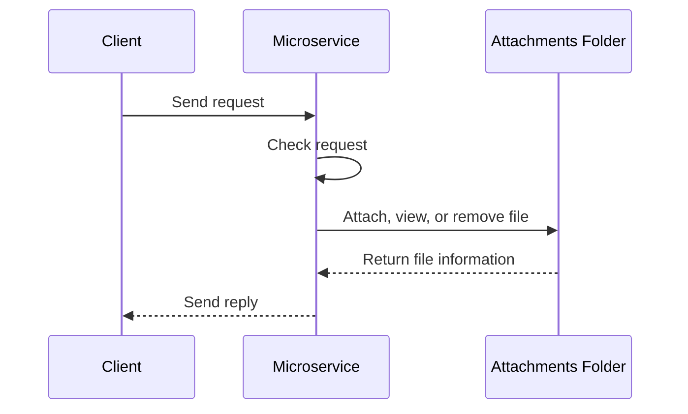

# CS361-File-Attachment
Microservice for adding files to items.

## Description
This microservice lets applications attach files, see what files are attached, and remove files from items.
It uses Python, ZeroMQ, and JSON messages on port 5558. Files are saved in an `attachments` folder so they don't disappear when the program stops. Files can be up to 25 MB.

## How to Request Data
The client sends a JSON request to the microservice using ZeroMQ.

Example of attaching a file:

```python
import zmq
import base64

context = zmq.Context()
socket = context.socket(zmq.REQ)
socket.connect("tcp://localhost:5558")

with open("notes.txt", "rb") as f:
    file_data = base64.b64encode(f.read()).decode("utf-8")

request = {
    "action": "attach",
    "app": "notepad",
    "item_id": 5,
    "file_name": "notes.txt",
    "file_data": file_data
}

socket.send_json(request)
```

There are three actions available:
- `attach` — Adds a file to an item.
- `view` — Shows the files attached to an item.
- `remove` — Removes a file from an item.

Example of viewing files:

```python
request = {
    "action": "view",
    "app": "notepad",
    "item_id": 5
}

socket.send_json(request)
```

Example of removing a file:

```python
request = {
    "action": "remove",
    "app": "notepad",
    "item_id": 5,
    "file_name": "notes.txt"
}

socket.send_json(request)
```
* `'app'` tells the microservice which application is using it.
* `'item_id'` tells it which item the file belongs to (can be a string or integer), and `'file_name'` is the name of the file.
* `'file_data'` is the file's contents encoded.

## How to Receive Data
After sending a request, the client gets the reply using:

```python
reply = socket.recv_json()
print(reply)
```

Example reply after attaching a file:

```json
{
    "status": "success",
    "message": "notes.txt attached to item 5"
}
```

Example reply after viewing files:

```json
{
    "status": "success",
    "item_id": 5,
    "files": [
        {
            "file_name": "notes.txt",
            "size_bytes": 100
        }
    ]
}
```

The file size is just an example.

Example reply after removing a file:

```json
{
    "status": "success",
    "message": "notes.txt removed from item 5"
}
```

If the file isn't found, the microservice returns an error:

```json
{
    "status": "error",
    "message": "No file named notes.txt on item 5"
}
```

## UML Sequence Diagram



## How to Run
Install the required library:

```bash
pip install pyzmq
```
Start the microservice:
```bash
python attachment_service.py
```
Then run the client program separately to send requests.
The microservice will keep listening for requests on port 5558 until it is stopped.
